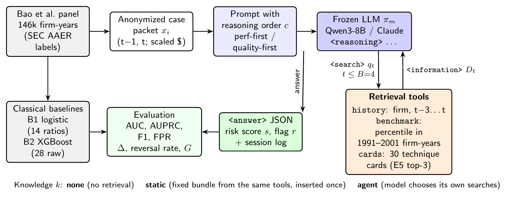
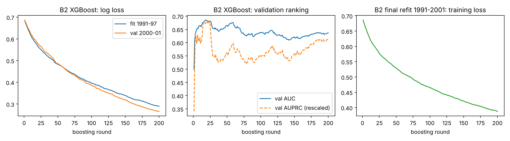

# Chain-of-Thought Reasoning Order and Search-Agent Retrieval in LLM Financial Fraud Detection

**Ryan Khan** · IDAI-780 Capstone, Rochester Institute of Technology, Fall 2026 · Instructor: Zhiqiang Tao

Can a large language model screen financial statements for signs of material misstatement, and does the *order* in which it reasons change its judgment? This repository tests a frozen LLM under two reasoning orders, **performance-first** (growth, margins and ROA, the headline story management leads with) and **quality-first** (accruals, cash conversion, receivables, inventory and soft assets). Each order runs with three knowledge settings: no retrieval, a static retrieval bundle, and a **search agent** that decides for itself what to look up. Classical models trained on the same data serve as baselines. Two frozen models are compared: open-weight **Qwen3-8B** and **Claude Sonnet 5.5**.

**Key findings (60 balanced out-of-sample test cases).** A trained XGBoost on 28 accounting items (AUC 0.76) beats every LLM setting (AUC 0.45–0.61, all CIs include chance). The reasoning order matters mainly when the model searches: with the agent, performance-first lowers the risk score by 2.6 points for Qwen and 2.0 for Claude (Claude: 95% CI [−4.0, −0.1], Wilcoxon p = 0.04, uncorrected). The agent does not beat static retrieval, but its logs show the mechanism: quality-first reasoning makes both models look up more earnings-quality items.



*Figure 1. Dataflow. Each test firm-year becomes an anonymized case packet. The prompt fixes the reasoning order c. In the agent setting, the frozen LLM interleaves `<reasoning>` steps with up to B = 4 `<search>` calls to three leakage-safe tools, following the rollout of Search-R1 (Jin et al., 2025) but without RL training. Every answer and retrieval is logged and scored against classical baselines on the same cases.*

---

## Contents

```
├── README.md
├── requirements.txt
├── docs/cp3_report.pdf              Checkpoint 3 report (method formulation, results)
├── assets/framework.png             project figure
├── data/
│   ├── README.md                    data source, download, preparation
│   ├── cards/technique_cards.jsonl  30 forensic-accounting technique cards (original text)
│   └── samples/                     4 anonymized case packets (what the model sees)
├── notebooks/
│   ├── cp3_search_agent_colab.ipynb full pipeline on a Colab GPU (with outputs of the reported run)
│   └── cp2_baseline_colab.ipynb     CP2 baseline notebook (kept for reproducibility)
├── src/
│   ├── data.py                      download, temporal split, serial-fraud fix, preprocessing
│   ├── metrics.py                   AUC, AUPRC, top-1% metrics, F1, FPR, score separation
│   ├── train_classical.py           B0 random, B1 logistic regression, B2 XGBoost (+ training curves, checkpoints)
│   ├── llm_baseline.py              CP2 zero-shot LLM baseline (Direct vs. CoT)
│   ├── agent/
│   │   ├── tools.py                 history / benchmark / cards tools, static bundle, leakage guards
│   │   ├── prompts.py               reasoning-order x knowledge conditions
│   │   ├── loop.py                  search-agent loop (open models: text tags; Claude: native tool use)
│   │   └── backends.py              Hugging Face (batched), vLLM, mock backends
│   ├── run_agent.py                 runs the condition grid on the same cases
│   ├── evaluate_agent.py            comparison table, order bias, knowledge gain, bootstrap CIs, figures
│   ├── evaluate.py                  CP2 evaluation
│   ├── check_run.py                 sanity check of a results file (parse rate, order effect, searches)
│   └── show_trace.py                pretty-prints an agent session
├── scripts/
│   ├── demo.sh                      one-command demo (training snapshot + 4-case agent batch)
│   └── update_readme_results.py     pastes results/tables/comparison.md into this README
├── tests/test_agent.py              17 tests: parser, budget cutoff, leakage, retrieval determinism, prompt symmetry, schema
└── results/                         logs, training curves, checkpoints, session logs, tables, figures
```

## Method

**Data.** Bao et al. (2020) public panel: 146,045 U.S. firm-years from 1990–2014. The label is a later SEC Accounting and Auditing Enforcement Release (AAER). Inputs are 28 raw financial-statement items and 14 Dechow et al. (2011) ratios. The split is temporal: train on 1991–2001, test on 2003–2008, with a two-year gap and Bao et al.'s serial-fraud relabelling. Hyperparameters are selected on 1991–1997 → 2000–2001 only.

**Case packet.** A balanced sample of test firm-years. Each packet shows years t−1 and t and the 14 ratios. Firm IDs and calendar years are removed, and every dollar amount is multiplied by a random per-case constant, so the firm cannot be looked up by size.

**Inference model.** A frozen LLM π_m produces a trajectory τ = (t₁, q₁, D₁, …, t_T, a) with T ≤ B:

π_m(τ | x_i; c) = ∏_t π_m(t_t, q_t | x_i, c, τ_<t),  D_t = TopK_{d ∈ 𝒟_i} sim(q_t, d)

Retrieved passages D_t are inserted inside `<information>`. The model conditions on them but does not generate them. The answer a is a JSON object with a risk score s ∈ [0, 100] and a red flag r = 𝟙[s ≥ τ], where τ is fit on a separate dev split (2000–2001 cases) and never on test cases.

**Tools.** All three are built from information available at the end of year t:

| Tool | Returns | Leakage guard |
|---|---|---|
| `history: ITEM` | The firm's own values for t−3 … t, scaled like the packet | Asserts no year after t |
| `benchmark: ITEM` | Percentile of the firm's ratio among 1991–2001 firm-years | Reference window ends before every test year; no labels used |
| `cards: TEXT` | Top-3 of 30 technique cards (E5 dense retrieval; TF-IDF fallback) | General knowledge, no case content |

**Conditions** (`order-knowledge`): `direct-none`, `perf-none`, `qual-none`, `perf-static`, `qual-static`, `perf-agent`, `qual-agent`. The two orders use exactly the same words; only the order of the analysis blocks differs (unit-tested). Static RAG inserts a fixed bundle from the same tools: history of four key items, benchmarks for all ratios, and the top-6 cards for the firm's most extreme ratios.

**Quantities tested.**

- Order bias: Δ_i = s_i(perf) − s_i(qual), |Δ|, and the red-flag reversal rate.
- Knowledge gain: G = AUPRC(agent) − AUPRC(static), with paired bootstrap CIs.
- Query focus: the share of the agent's lookups aimed at quality items vs. performance items under each order.

**Models.**

- `Qwen/Qwen3-8B`: Transformers, bf16 on one A100 (80 GB), greedy decoding, built-in thinking off. Its answer is pre-filled with the first reasoning block (`<reasoning>\n(1) Performance:` or `(1) Earnings quality:`), so each session starts in the order its condition prescribes.
- `claude-sonnet-5-5`: the oracle. It uses the same tools through native API tool use, at effort low (Direct) or high (CoT). Claude does not write out its reasoning, so its order condition is an instruction only.

## Setup

```bash
git clone https://github.com/x4teen/fraud-cot-search-agent.git
cd fraud-cot-search-agent
python -m venv .venv && source .venv/bin/activate      # Python 3.10+  (Windows: .venv\Scripts\activate)
pip install -r requirements.txt
export ANTHROPIC_API_KEY=...                           # only for the Claude oracle
export ANTHROPIC_WORKSPACE_ID=wrkspc_...               # only if the key is not workspace-scoped
```

A GPU with 24 GB or more runs Qwen3-8B in bf16. On a 16 GB GPU, set `HF_4BIT=1`. Everything else (data, classical baselines, evaluation, tests) runs on a CPU, and `results/` already holds every session log, so `python -m src.evaluate_agent --tau-from-dev` reproduces all tables and figures without a GPU or API key. On Google Colab, open `notebooks/cp3_search_agent_colab.ipynb` and run the cells in order.

## Data preparation

The dataset downloads automatically to `data/` on first use (about 48 MB, from github.com/JarFraud/FraudDetection). To fetch it explicitly:

```bash
python -c "from src import data; data.download()"
```

Preprocessing happens inside the pipeline:

- infinite values are set to missing;
- median imputation and 1st/99th-percentile winsorizing, fit on training years only (classical models);
- temporal split with the serial-fraud correction;
- balanced case sampling and anonymized packet construction (`src/run_agent.py`).

See [`data/README.md`](data/README.md) for details.

## Training and testing

```bash
# 0) unit tests
pytest

# 1) training snapshot: classical baselines (CPU, ~15 s)
python -m src.train_classical
#    -> results/logs/train_classical.log, results/training_curves/*.csv,
#       results/checkpoints/B2_xgboost_raw28/round_{50,100,150}.ubj + final.json,
#       results/figures/training_curves.png

# 2) dev split, used only to fit the red-flag threshold
python -m src.run_agent --backend hf --model Qwen/Qwen3-8B --split dev --n 20

#    sanity-check it before the full run
python -m src.check_run results/agent_hf_Qwen-Qwen3-8B_dev.jsonl

# 3) full condition grid on the out-of-sample test cases
python -m src.run_agent --backend hf --model Qwen/Qwen3-8B --split test --n 60
python -m src.run_agent --backend claude --model claude-sonnet-5-5 --split dev --n 20
python -m src.run_agent --backend claude --model claude-sonnet-5-5 --split test --n 60

# 4) evaluation: tables + figures in results/tables and results/figures
python -m src.evaluate_agent --tau-from-dev
python scripts/update_readme_results.py

# demo: training snapshot + one batch of 4 cases with the live agent trace
bash scripts/demo.sh Qwen/Qwen3-8B          # or: bash scripts/demo.sh mock  (no GPU; Windows: run in Git Bash)
```

Every session is logged as one JSON line in `results/agent_<backend>_<model>_<split>.jsonl`. Each line holds the case ID, true label, condition, prompt hash, every query with its retrieved IDs, malformed or forced-answer flags, the raw output and the parsed score.

## Results

### Classical baselines (full out-of-sample test set, 35,166 firm-years, 261 later-AAER)

| Model | Selected setting | Val. AUC (2000–01) | Test AUC | Test AUPRC | Precision @ top 1% |
|---|---|---|---|---|---|
| B0 random | — | — | 0.521 | 0.008 | 0.009 |
| B1 logistic regression, 14 ratios | C = 1 | 0.675 | 0.674 | 0.013 | 0.011 |
| B2 XGBoost, 28 raw variables | depth 3, 200 trees | 0.637 | **0.725** | **0.015** | 0.017 |

B2 matches Bao et al.'s published RUSBoost test AUC (about 0.71). A random ranker's AUPRC equals the prevalence, 0.0074. CP2 reported a B2 AUC of 0.697 with depth 4. The selected setting depends on the XGBoost version, which is now pinned to 3.4.1.



*Figure 2. B2 training snapshot: per-round log loss on the fitting and validation windows, validation AUC/AUPRC, and the training loss of the final refit.*

### LLMs and search agent vs. baselines (balanced test cases)

<!-- RESULTS:START -->
All methods are scored on the **same 60 balanced test firm-years from 2003–2008** (30 later-AAER, 30 not). LLM red-flag thresholds were fit on a separate 20-case dev split from 2000–2001. Brackets are 95% case-bootstrap intervals; AUPRC of a random ranker here is 0.50.

**Detection**

| Model | Condition (order · knowledge) | AUC | AUPRC [95% CI] | F1 | FPR | Searches / case |
|---|---|---|---|---|---|---|
| B0 | random | 0.582 | 0.570 [0.42, 0.77] | 0.53 | 0.47 | – |
| B1 | logistic regression, 14 ratios | 0.623 | 0.591 [0.44, 0.78] | 0.60 | 0.40 | – |
| B2 | **XGBoost, 28 items** | **0.764** | **0.756 [0.58, 0.89]** | 0.67 | 0.33 | – |
| Qwen3-8B | direct · none (CP2 Direct) | 0.531 | 0.528 [0.38, 0.67] | 0.68 | 0.93 | 0 |
| Qwen3-8B | perf · none | 0.569 | 0.554 [0.40, 0.71] | 0.66 | 0.90 | 0 |
| Qwen3-8B | qual · none | 0.610 | 0.580 [0.43, 0.73] | 0.66 | 0.83 | 0 |
| Qwen3-8B | perf · static | 0.507 | 0.524 [0.39, 0.67] | 0.67 | 0.93 | 0 |
| Qwen3-8B | qual · static | 0.450 | 0.504 [0.37, 0.66] | 0.65 | 0.90 | 0 |
| Qwen3-8B | perf · agent | 0.514 | 0.511 [0.37, 0.66] | 0.46 | 0.43 | 2.4 |
| Qwen3-8B | qual · agent | 0.526 | 0.523 [0.37, 0.67] | 0.67 | 0.93 | 2.6 |
| Claude Sonnet 5.5 | direct · none | 0.530 | 0.568 [0.40, 0.73] | 0.38 | 0.27 | 0 |
| Claude Sonnet 5.5 | perf · none | 0.530 | 0.537 [0.39, 0.71] | 0.63 | 0.87 | 0 |
| Claude Sonnet 5.5 | qual · none | 0.525 | 0.569 [0.41, 0.73] | 0.67 | 1.00 | 0 |
| Claude Sonnet 5.5 | perf · static | 0.539 | 0.585 [0.43, 0.74] | 0.67 | 0.97 | 0 |
| Claude Sonnet 5.5 | qual · static | 0.543 | 0.542 [0.38, 0.73] | 0.58 | 0.70 | 0 |
| Claude Sonnet 5.5 | perf · agent | 0.558 | 0.578 [0.42, 0.74] | 0.62 | 0.70 | 0.62 |
| Claude Sonnet 5.5 | qual · agent | 0.553 | 0.596 [0.43, 0.75] | 0.67 | 0.90 | 1.05 |


**H1 — reasoning-order effect**, Δ = risk(performance-first) − risk(quality-first), paired per case:

| Model | Knowledge | Pairs | Mean Δ [95% CI] | Mean \|Δ\| | Wilcoxon p |
|---|---|---|---|---|---|
| Qwen3-8B | none | 60 | −0.08 [−2.17, 1.83] | 3.75 | 0.70 |
| Qwen3-8B | static | 58 | −1.38 [−5.17, 1.56] | 6.55 | 0.95 |
| Qwen3-8B | agent | 60 | −2.58 [−5.67, 0.00] | 5.58 | 0.29 |
| Claude Sonnet 5.5 | none | 60 | +0.50 [−1.40, 2.39] | 4.23 | 0.71 |
| Claude Sonnet 5.5 | static | 60 | −1.12 [−2.90, 0.75] | 4.12 | 0.12 |
| Claude Sonnet 5.5 | agent | 60 | **−2.00 [−3.98, −0.07]** | 5.43 | **0.04** |

p-values are not corrected for the six tests.


**H3 — knowledge gain** G = AUPRC(agent) − AUPRC(static), paired bootstrap:

| Model | Order | G [95% CI] |
|---|---|---|
| Qwen3-8B | perf | −0.008 [−0.068, 0.061] |
| Qwen3-8B | qual | +0.024 [−0.048, 0.102] |
| Claude Sonnet 5.5 | perf | −0.008 [−0.074, 0.058] |
| Claude Sonnet 5.5 | qual | +0.054 [−0.025, 0.118] |

**Mechanism — what the agent looked up**

| Model | Order | Queries | Earnings-quality items | Performance items | Cards | First query on quality |
|---|---|---|---|---|---|---|
| Qwen3-8B | perf | 144 | 40% | 19% | 37% | 64% |
| Qwen3-8B | qual | 156 | 46% | 24% | 28% | 80% |
| Claude Sonnet 5.5 | perf | 37 | 43% | 46% | 3% | 33% |
| Claude Sonnet 5.5 | qual | 63 | 56% | 38% | 2% | 40% |

**Limitations.** n = 60 gives wide intervals; Qwen uses only 3–5 distinct risk scores; performance-first is a numbers-only proxy for management narrative (8-K/MD&A text is future work); per-condition dev thresholds make raw red-flag reversal rates hard to compare across orders.
<!-- RESULTS:END -->

## References

- Bao, Y., Ke, B., Li, B., Yu, Y. J., & Zhang, J. (2020). Detecting accounting fraud in publicly traded U.S. firms using a machine learning approach. *Journal of Accounting Research*, 58(1), 199–235.
- Jin, B., Zeng, H., Yue, Z., et al. (2025). Search-R1: Training LLMs to reason and leverage search engines with reinforcement learning. *COLM 2025*. arXiv:2503.09516.
- Dechow, P. M., Ge, W., Larson, C. R., & Sloan, R. G. (2011). Predicting material accounting misstatements. *Contemporary Accounting Research*, 28(1), 17–82.
- Wang, L., et al. (2022). Text embeddings by weakly-supervised contrastive pre-training (E5). arXiv:2212.03533.
- Yang, A., et al. (2025). Qwen3 technical report. arXiv:2505.09388.
- Chen, T., & Guestrin, C. (2016). XGBoost: A scalable tree boosting system. *KDD*.

## Acknowledgments

- The dataset and the temporal-split and serial-fraud design come from Bao et al. (2020). Their data is public at [JarFraud/FraudDetection](https://github.com/JarFraud/FraudDetection). Thank you to the authors for releasing it.
- The agent loop adapts the rollout of [Search-R1](https://github.com/PeterGriffinJin/Search-R1) (tag protocol, retrieved-text insertion, retry on malformed actions) for a frozen model.
- Built on Hugging Face Transformers, sentence-transformers (E5), XGBoost, scikit-learn and the Anthropic Python SDK. Qwen3-8B by the Qwen team (Alibaba); Claude by Anthropic.
- The technique cards are original paraphrases written for this project. They are informed by general forensic-accounting practice and by *Financial Shenanigans* (Schilit, Perler & Engelhart). No text from the book is reproduced.
- Thanks to Prof. Zhiqiang Tao for feedback on the proposal and checkpoints.

*This project screens for warning signs that deserve further review. It does not determine that fraud occurred.*
